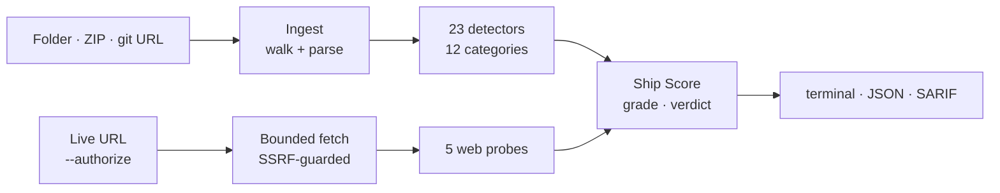

<div align="center">


### Your AI agent shipped the code. immunogen makes sure it didn't ship an infection.

[](https://github.com/Mocinjay/immunogen/releases/latest)
[](https://github.com/Mocinjay/immunogen/actions/workflows/ci.yml)
[](./LICENSE)
[](https://nodejs.org)
[](#ci-integration)

[Quickstart](#quickstart) · [What it catches](#what-it-catches) · [CI integration](#ci-integration) · [Live URL screening](#screen-a-live-url) · [Changelog](./CHANGELOG.md)

<br />


</div>

<br />

**immunogen** is a static security scanner for apps built with AI coding agents — Cursor, Claude Code, Lovable, Bolt, v0, Replit. Point it at a project and it returns a **0–100 Ship Score**, an **A–F grade**, and every launch-blocking problem with its exact `file:line`: leaked keys, unauthenticated routes, missing row-level security, unverified payment webhooks, vulnerable dependencies — and the AI layer itself (agent rules, skills, MCP servers), which most scanners never look at.

- **Deterministic** — the same code always produces the same report. No LLM decides what counts as a finding.
- **Never runs your code** — static analysis only, and secrets are redacted in every output format.
- **Offline-first** — a local scan's only network call is an OSV.dev lookup of package names and versions; `--offline` removes it.
- **Covers the AI layer** — prompt injection, data exfiltration and MCP tool poisoning in skills, rules and agent prompts.
- **Repo, git URL or live site** — scan a folder, a ZIP, a GitHub/GitLab/Bitbucket URL, or (with consent) a deployed website.
- **CI-native** — exit codes gate the build; SARIF output feeds GitHub code scanning.

Works on JavaScript / TypeScript, Python and Go.

## Quickstart

Requires **Node.js 22+**. Install the latest release:

```sh
npm install -g https://github.com/Mocinjay/immunogen/releases/latest/download/immunogen.tgz
```

Run it in your project folder:

```sh
immunogen
```

That's it — no account, no API key. Scan another folder with `immunogen ./path/to/app`, or a remote repo with `immunogen https://github.com/owner/repo`.

<details>
<summary><b>Other ways to run it</b> — npx, per-project, Docker</summary>

<br />

One-off run without installing (pinned to a release, because npx caches whatever a URL first downloaded):

```sh
npx --yes --package=https://github.com/Mocinjay/immunogen/releases/download/v0.2.0/immunogen-0.2.0.tgz immunogen
```

As a project dev dependency (CI gate or library use):

```sh
npm install --save-dev https://github.com/Mocinjay/immunogen/releases/latest/download/immunogen.tgz
```

In Docker, with no Node toolchain at all:

```sh
docker build -t immunogen https://github.com/Mocinjay/immunogen.git
docker run --rm -v "$PWD:/app" immunogen /app
```

</details>

## How grading works


Every finding costs points by severity (CRITICAL 50, HIGH 25, MEDIUM 10, LOW 5), and the remaining score maps to a grade. **A single CRITICAL finding** — one leaked production key, one unauthenticated payment route — **is an automatic F** and blocks the verdict, however clean the rest of the project is. The verdict is `blocked` on any CRITICAL finding or a score below 40, and `pass` otherwise.

## What it catches

23 detectors across 12 categories on a repo scan, plus 5 web probes when you screen a live URL.

| Category | What it catches |
|---|---|
| **Secrets** | Hardcoded provider keys (Stripe, AWS, OpenAI incl. `sk-proj-`, Anthropic, Gemini / Google `AIza` keys outside Firebase/Maps client config, Supabase `service_role` / `sb_secret_`, GitHub, Slack, SendGrid, Resend, Groq, xAI, Hugging Face, Replicate, npm), committed private keys and service-account JSON, committed `.env` files, high-entropy tokens (prose, URLs, hashes and lockfiles are ignored) |
| **Client-bundle exposure** | Secret-named env vars inlined into the client via `NEXT_PUBLIC_` / `VITE_` / `EXPO_PUBLIC_` / `REACT_APP_` / `NUXT_PUBLIC_` / `GATSBY_` (public-by-design keys such as the Supabase anon key are not flagged); LLM SDKs running in the browser with `dangerouslyAllowBrowser` |
| **Auth & RLS** | Unauthenticated routes — Next.js App Router handlers, Pages Router API routes, Server Actions, Express / Fastify / Hono / Koa, FastAPI / Flask, Go (Gin / Echo / Chi / Fiber / net/http); Supabase tables without RLS and `using (true)` write policies; open Firebase rules; JWTs decoded without verification; auth tokens in `localStorage` |
| **Abuse / rate limiting** | Paid-LLM endpoints and login / sign-up / password-reset endpoints with no rate limiting |
| **Payment safety** | Stripe webhooks that skip signature verification; charge amounts taken from the request |
| **Dependencies** | Known vulnerabilities in every resolved package, direct and transitive, from npm / pnpm / yarn / bun / Poetry / uv / Pipenv lockfiles or manifests — rated by each advisory's real severity, with an offline fallback |
| **Injection / XSS** | Unsanitized `dangerouslySetInnerHTML`; SQL built by string interpolation; `eval` / `exec` / shell / unsafe YAML or pickle on dynamic input; server-side request forgery; open redirects |
| **CORS & headers** | Wildcard or reflected origins combined with credentials; missing Content-Security-Policy |
| **Storage** | Public Firebase / Firestore / Storage rules; Supabase buckets with no access policy |
| **Legal** | No privacy policy or terms when the app collects user data |
| **Config / debug** | Whole-environment dumps (`process.env`, `os.environ`, `os.Environ()`) to logs or HTTP responses |
| **AI layer** | Prompt-injection strings, data-exfiltration directives, MCP tool poisoning and least-privilege gaps in skills, rules and agent prompts |

## How it compares

| | **immunogen** | [vibe-check.cloud][vc] | [benavlabs/vibe-check][bv] | [Vibe App Scanner][vas] |
|---|:---:|:---:|:---:|:---:|
| Free / open source | ✅ MIT | ✅ | ✅ MIT | ❌ paid |
| Deterministic engine — no LLM, reproducible | ✅ | ❌ AI-driven | ❌ AI-driven | ~ hosted |
| Static repo scan (never executes your code) | ✅ | ✅ | ✅ | ❌ dynamic |
| Live URL / deployed-app scan | ✅ | ❌ | ❌ | ✅ |
| Scans the **AI layer** (skills / MCP / agent prompts) | ✅ deep | ~ partial | ❌ | ❌ |
| SARIF output for a CI gate | ✅ | ❌ | ❌ | ❌ |

<sub>✅ yes · ~ partial · ❌ no / not documented. Compared against each tool's public docs and README as of July 2026 — something wrong? Open a PR.</sub>

[vc]: https://vibe-check.cloud/
[bv]: https://github.com/benavlabs/vibe-check
[vas]: https://vibeappscanner.com/

## Usage

```sh
immunogen [path] [options]
```

`path` is a local folder (default: the current directory), a ZIP file, a git repository URL (GitHub, GitLab, Bitbucket, Codeberg or any `.git` URL), or a live `https://` URL to screen.

| Option | Description |
|---|---|
| `--format <format>` | `terminal` (default), `json` (a stable `ScanResult`), or `sarif` (GitHub code scanning and other SARIF tools). |
| `--offline` | Never touch the network: check dependencies against the bundled advisory list instead of OSV.dev. |
| `--no-ignore` | Disregard `.immunogenignore` and inline `immunogen-ignore` comments — for auditing a repo you don't control. |
| `--no-llm` | Disable LLM fix prompts (already the default; explicit for scripts). |
| `--authorize` | Required consent to screen a live URL. Only screen sites you own or are authorized to test. |
| `--allow-private` | Let live-URL screening reach loopback / private hosts (local dev only). |
| `-v, --version` | Print the installed version. |

| Exit code | Meaning |
|:---:|---|
| `0` | Verdict `pass` |
| `1` | Verdict `blocked` — fail the build |
| `2` | The scan could not run (bad path, missing `--authorize`, refused host, …) |

### Suppressing findings

Accept a reviewed finding with a comment on its line or the line above — bare to cover every rule there, or with rule IDs to cover just those:

```ts
// immunogen-ignore AUTH-01 — public newsletter signup, rate-limited upstream
export async function POST(req: Request) { /* ... */ }
```

Exclude whole paths (vendored code, seed data) with a `.immunogenignore` file at the scan root, in `.gitignore` syntax. Route handlers can also be marked with a `// public` comment.

<details>
<summary><b>Library API</b></summary>

<br />

```js
import { scan } from "immunogen";

const result = await scan("./my-app");
console.log(result.score.grade, result.score.score, result.findings.length);
```

`scan(path, options?)` returns a `ScanResult`: `{ target, scannedAt, stackHints, findings, score, llmEnriched, scanIncomplete, diagnostics }`.

- `score` — `{ score, grade, gradeLabel, band, verdict, criticalCount, highCount }`
- `findings` — severity-sorted, each with `ruleId`, `category`, `severity`, `confidence`, `file`, `line`, `message`, `remediation`
- `diagnostics` — every non-fatal warning (unparseable files, files over the size cap, a truncated walk, LLM or URL-probe failures); `scanIncomplete` is `true` whenever coverage was reduced

Ships as ESM and CommonJS with TypeScript types.

</details>

<details>
<summary><b>Optional LLM fix prompts</b></summary>

<br />

immunogen never calls an LLM unless you configure one. To add copy-paste fix prompts to HIGH and CRITICAL findings:

| Env var | Purpose |
|---|---|
| `IMMUNOGEN_PROVIDER` | `anthropic` or `openai` |
| `ANTHROPIC_API_KEY` | Required when the provider is `anthropic` |
| `OPENAI_API_KEY` | Required when the provider is `openai` |
| `OPENAI_BASE_URL` | Optional OpenAI-compatible endpoint (e.g. a local Ollama server) |
| `IMMUNOGEN_MODEL` | Optional model override. Defaults: `claude-haiku-5-5` (Anthropic), `gpt-4o-mini` (OpenAI). Required for OpenAI-compatible servers, which serve their own model names |

Every snippet is redacted before it is sent — no source file and no matched secret ever leaves your machine. Scoring never depends on the LLM.

</details>

## CI integration

Gate every push and pull request, and send findings to the repository's **Security → Code scanning** tab:

```yaml
name: immunogen

on: [push, pull_request]

permissions:
  contents: read
  security-events: write

jobs:
  screen:
    runs-on: ubuntu-latest
    steps:
      - uses: actions/checkout@v7

      - uses: actions/setup-node@v7
        with:
          node-version: "22"

      - name: Screen with immunogen
        run: npx --yes --package=https://github.com/Mocinjay/immunogen/releases/download/v0.2.0/immunogen-0.2.0.tgz immunogen . --format sarif > results.sarif

      - name: Upload SARIF
        if: always()
        uses: github/codeql-action/upload-sarif@v4
        with:
          sarif_file: results.sarif
```

A `blocked` verdict fails the step; `if: always()` still uploads the findings when it does. Alert fingerprints don't depend on line numbers, so alerts keep their identity when unrelated edits move code around.

## Screen a live URL

```sh
immunogen https://myapp.com --authorize
```

A bounded, read-only probe of a deployed site. `--authorize` is a required consent gate — **only screen sites you own or are explicitly authorized to test.**

| Check | What it looks for |
|---|---|
| Security headers (`WEB-HDR`) | Missing or weak CSP, HSTS, `X-Frame-Options`, `X-Content-Type-Options`, `Referrer-Policy` |
| CORS (`WEB-CORS`) | Any-origin or reflected-origin access combined with credentials |
| Exposed files (`WEB-EXPOSED`) | A publicly served `.env`, `.git/config`, `.git/HEAD`, `config.json` or source map |
| Secrets in bundles (`WEB-SEC`) | Live-looking provider keys in same-origin scripts, redacted in output |
| Cookies (`WEB-COOKIE`) | Session cookies missing `Secure`, `HttpOnly` or a strong `SameSite` |

<details>
<summary><b>SSRF protection</b></summary>

<br />

Every request — the page, each redirect hop, each script, each probe — is checked against the addresses its host resolves to. Loopback, private, link-local (including cloud metadata such as `169.254.169.254`), CGNAT, reserved and IPv6 equivalents are refused, and each connection is pinned to the addresses that passed the check, so a DNS-rebinding server can't swap in an internal address afterwards. Redirects are followed by hand with a hop limit; probes never follow redirects; an SPA's catch-all page served for `/.env` isn't reported as a leak. `--allow-private` lifts the guard for local development. URL mode never calls an LLM.

</details>

## Use as a Claude Code skill

immunogen ships a [Claude Code skill](./.claude/skills/immunogen) that runs the same deterministic scan and returns the graded report — a test checks that the skill and the library report the same Ship Score and findings count.

```
/immunogen ./my-app
/immunogen https://myapp.com --authorize
```

<details>
<summary><b>Install the skill</b></summary>

<br />

```sh
git clone https://github.com/Mocinjay/immunogen.git
cd immunogen && pnpm install && pnpm build
ln -s "$PWD/.claude/skills/immunogen" ~/.claude/skills/immunogen
```

The symlink keeps the skill in sync when you rebuild; copying the folder also works if immunogen is installed as a package (see [Quickstart](#quickstart)).

</details>

## Architecture



Scanned code is only ever read, never imported or executed; each file is parsed at most once and released before the next.

## Roadmap

Planned: Django and Rails route coverage, slopsquatting / hallucinated-package detection, and cross-file data flow for injection rules. See the [changelog](./CHANGELOG.md) for what has shipped.

## Contributing

Contributions that add detection coverage, cut false positives or improve reporters are welcome — see [CONTRIBUTING.md](./CONTRIBUTING.md) for setup, how to add a detector, and conventions.

**Security issues in immunogen itself** (not in a repo you scanned) should be reported privately — see [SECURITY.md](./SECURITY.md).

## License

[MIT](./LICENSE). Code adapted from NVIDIA SkillSpector (Apache-2.0) keeps its original license and attribution — see [NOTICE](./NOTICE) and [THIRD_PARTY_NOTICES.md](./THIRD_PARTY_NOTICES.md).
